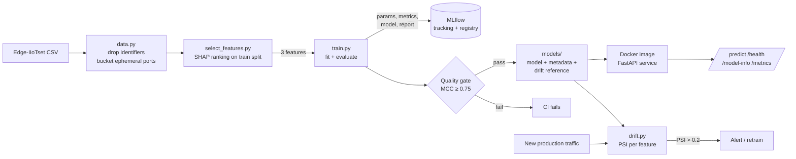

# IoT Intrusion Detection — MLOps Pipeline

A production-style pipeline for detecting attacks in IoT network traffic on the
**Edge-IIoTset** dataset. It removes leaky identifier features, selects a minimal feature
set with **SHAP**, tracks every run in **MLflow** (with a model registry), blocks weak models
with an automated **quality gate**, serves predictions through a **FastAPI** service with
**Prometheus** metrics, checks incoming traffic for **data drift**, and runs in **GitHub
Actions CI** with a **Docker** image.

It builds on my research audit of Edge-IIoTset, which found that much of the benchmark's
reported accuracy comes from identifier-like columns leaking into the model rather than
from real traffic behaviour. This project turns the leakage-safe model into something
deployable.

## Results on Edge-IIoTset

Binary classification (normal vs attack) on `ML-EdgeIIoT-dataset.csv` (157,800 rows,
156,986 after removing duplicates), stratified 80/20 split, seed 42. Reproduce with
`python scripts/run_experiments.py`.

| Run | Features | MCC | Macro F1 | Accuracy | Size | Latency (ms / 1k rows) |
|---|---|---|---|---|---|---|
| leaky-baseline (raw port, NOT safe) | 28 | 0.914 | 0.957 | 0.977 | 16.9 KB | 0.13 |
| dt-all-features | 27 | 0.808 | 0.898 | 0.952 | 10.5 KB | 0.14 |
| rf-all-features | 27 | 0.809 | 0.898 | 0.953 | 2386.7 KB | 5.37 |
| **production (SHAP-selected)** | **3** | **0.807** | **0.897** | **0.952** | **11.0 KB** | **0.07** |

Latency varies slightly between machines and runs.

**What the numbers show**

- **Leakage inflates scores.** Keeping the raw destination port lifts MCC from 0.81 to 0.91.
  Most destination-port values are ephemeral client ports (e.g. 47924) that identify a single
  connection. A random row split puts packets from the same connection in both train and
  test, so the model memorises port numbers instead of learning behaviour.
- **The fix is feature engineering, not deletion.** Dropping the port entirely collapses MCC
  to about 0.46, because ports below 32768 do carry signal: they identify the targeted
  service (80 = HTTP, 1883 = MQTT, 502 = Modbus). The derived feature `tcp.dstport_service`
  keeps service ports and maps every ephemeral port to one bucket.
- **3 features are enough.** SHAP ranking on the training split picks `tcp.dstport_service`,
  `tcp.flags` and `tcp.len`, which match the 27-feature model within 0.002 MCC.
- **A bigger model doesn't help.** A 200-tree random forest scores the same as one decision
  tree but is over 200× larger and much slower. Performance is limited by the information
  in the leakage-safe features, not by model capacity.

## Architecture



## What it demonstrates

| MLOps practice | Where |
|---|---|
| Config-driven, reproducible training | `config.yaml`, fixed seeds, config logged to every run |
| Experiment tracking and model registry | MLflow: params, metrics, model size, latency, signature, versions |
| Leakage prevention | Identifier columns dropped; ephemeral ports bucketed; tests assert raw identifiers never reach the model |
| Feature selection | SHAP ranking computed on training data only, smallest set within 0.005 MCC of all features |
| Automated quality gate | Training exits non-zero if MCC < `quality_gate.min_mcc`; CI fails |
| Training/serving consistency | The same `add_derived()` transform runs in training and in the API |
| Model serving | FastAPI with input validation (422 on missing inputs) |
| Monitoring | Prometheus counters for predictions and errors, latency histogram |
| Data drift detection | Population Stability Index against a reference profile saved at training time |
| CI/CD | GitHub Actions: lint → tests → train with gate → Docker build → container smoke test |
| Containerisation | Slim, non-root Docker image with a health check; docker-compose with an MLflow server |

## Setup

```bash
python -m venv .venv
# Windows: .venv\Scripts\activate      macOS/Linux: source .venv/bin/activate
pip install -e ".[dev]"
pytest -q                     # 16 tests: data, features, training, API, drift
```

## Run on the real dataset

1. Download Edge-IIoTset from
   [Kaggle](https://www.kaggle.com/datasets/mohamedamineferrag/edgeiiotset-cyber-security-dataset-of-iot-iiot).
   Copy `Edge-IIoTset dataset/Selected dataset for ML and DL/ML-EdgeIIoT-dataset.csv` to
   `data/edge_iiotset.csv`.
2. Run the pipeline:

```bash
python -m iot_ids.select_features --config config.yaml --write-config   # SHAP feature selection
python scripts/run_experiments.py                                       # all four runs + results table
mlflow ui --backend-store-uri sqlite:///mlflow.db                       # browse runs at localhost:5000
uvicorn iot_ids.api:app --port 8000                                     # API docs at localhost:8000/docs
```

`config.yaml` already contains the selected features, so `python -m iot_ids.train` alone
trains the production model.

Without the dataset, `make train-sample` (or the command in `.github/workflows/ci.yml`)
runs the pipeline on **synthetic** data. Those scores mean nothing; it only exists so tests
and CI run without the dataset.

## API

```bash
curl localhost:8000/health
curl localhost:8000/model-info      # features, metrics, MLflow run id, required inputs
curl -X POST localhost:8000/predict -H 'content-type: application/json' \
  -d '{"records": [{"tcp.dstport": 80, "tcp.flags": 24, "tcp.len": 512}]}'
curl localhost:8000/metrics/
```

Callers send raw values (`tcp.dstport`, not the bucketed feature). The service applies the
same transform as training. Each prediction returns a label (0 = normal, 1 = attack), the
attack probability and the MLflow run id of the model that made it.

## Drift monitoring

```bash
python -m iot_ids.drift new_traffic.csv --model-dir models
```

On real data, a sample with the usual traffic mix shows PSI ≤ 0.001 on every feature
(exit code 0). A sample containing only UDP/ICMP flood traffic is flagged on all three
features, with PSI > 2 (exit code 1), so it can trigger an alert or retraining in a scheduled job.

## Docker

```bash
python -m iot_ids.train && docker build -t iot-ids-api . && docker run --rm -p 8000:8000 iot-ids-api
# or the full stack with an MLflow server:
docker compose up -d mlflow
MLFLOW_TRACKING_URI=http://localhost:5000 python -m iot_ids.train
docker compose up -d --build api
```

## Project structure

```
config.yaml                   pipeline configuration (incl. SHAP-selected features)
src/iot_ids/
  config.py                   typed config loading
  data.py                     loading, identifier removal, port bucketing, splitting
  select_features.py          SHAP-guided minimal feature selection
  train.py                    training, evaluation, MLflow logging, quality gate
  drift.py                    PSI drift detection (library + CLI)
  api.py                      FastAPI service + Prometheus metrics
scripts/run_experiments.py    reproduces the results table
scripts/make_sample_data.py   synthetic data for tests and CI
tests/                        pytest suite
Dockerfile, docker-compose.yml, .github/workflows/ci.yml, Makefile
```

## Limitations and next steps

- The split is random by row, as in most Edge-IIoTset papers. Group-aware evaluation by
  connection or capture session would give a stricter estimate.
- Deploy the container to a cloud service (e.g. Azure Container Apps or Azure ML managed endpoints).
- Schedule the drift check on production traffic and trigger retraining automatically.

## Dataset

Edge-IIoTset: M. A. Ferrag, O. Friha, D. Hamouda, L. Maglaras and H. Janicke, "Edge-IIoTset: A
New Comprehensive Realistic Cyber Security Dataset of IoT and IIoT Applications for
Centralized and Federated Learning," *IEEE Access*, vol. 10, pp. 40281–40306, 2022. Free for
academic use; the dataset is not included in this repository.
